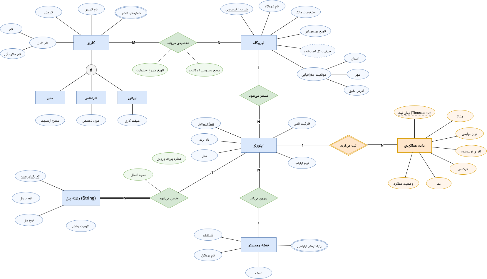

# فاز ۲ — مدل موجودیت-رابطه (ER)
**🇬🇧 [English](02-er-diagram.md) | 🇮🇷 فارسی**

ورودی: [`01-requirements.fa.md`](01-requirements.fa.md)
نمودار (فارسی): [`../diagrams/Helios-db-ER-fa.drawio.svg`](../diagrams/Helios-db-ER-fa.drawio.svg) · منبع [`../diagrams/Helios-db-ER-fa.drawio`](../diagrams/Helios-db-ER-fa.drawio)

## ۱. موجودیت‌ها

| موجودیت | ویژگی‌ها | کلید کاندید | توضیحات |
|---|---|---|---|
| **کاربر (User)** | `کد ملی`، `نام کاربری`، `نام کامل` (`نام`، `نام خانوادگی`)، `{شماره‌های تماس}` | `کد ملی`، `نام کاربری` | موجودیت قوی (موجودیت پدر در ارث‌بری). `نام کامل` ویژگی مرکب و `شماره‌های تماس` ویژگی چندمقداری است. |
| **مدیر (Admin)** | `سطح ارشدیت` | به ارث برده شده (`کد ملی`) | زیرمجموعه (Subtype) از موجودیت **کاربر**. |
| **کارشناس (Expert)** | `حوزه تخصص` | به ارث برده شده (`کد ملی`) | زیرمجموعه (Subtype) از موجودیت **کاربر**. |
| **اپراتور (Operator)** | `شیفت کاری` | به ارث برده شده (`کد ملی`) | زیرمجموعه (Subtype) از موجودیت **کاربر**. |
| **نیروگاه (Power_Plant)** | `شناسه اختصاصی`، `نام نیروگاه`، `مشخصات مالک`، `تاریخ بهره‌برداری`، `موقعیت جغرافیایی` (`استان`، `شهر`، `آدرس دقیق`)، `/ظرفیت کل نصب‌شده/` | `شناسه اختصاصی` | موجودیت قوی. `موقعیت جغرافیایی` ویژگی مرکب و `ظرفیت کل نصب‌شده` ویژگی مشتق (محاسبه‌شده از مجموع ظرفیت اینورترها) است. |
| **اینورتر (Inverter)** | `شماره سریال`، `نام برند`، `مدل`، `ظرفیت نامی`، `نوع ارتباط` | `شماره سریال` | موجودیت قوی که مبدل‌های برق مستقر در نیروگاه را نشان می‌دهد. |
| **رشته پنل (Panel_String)** | `کد یکتای رشته`، `تعداد پنل`، `نوع پنل`، `ظرفیت بخش` | `کد یکتای رشته` | موجودیت قوی که دسته‌ای از پنل‌های خورشیدی متصل‌به‌هم را نشان می‌دهد. |
| **نقشه رجیستر (Register_Map)** | `کد نقشه`، `نام پروتکل`، `نسخه`، `{پارامترهای ارتباطی}` | `کد نقشه` | موجودیت قوی. `پارامترهای ارتباطی` یک ویژگی چندمقداری است. |
| **داده عملکردی (Performance_Data)** | `زمان ثبت` (کلید جزئی)، `ولتاژ`، `توان تولیدی`، `انرژی تولیدشده`، `فرکانس`، `دما`، `وضعیت عملکرد` | `(شماره سریال، زمان ثبت)` | **موجودیت ضعیف** وابسته به **اینورتر** جهت نگهداری داده‌های سری‌زمانی (لاگ‌های عملکرد). |

## ۲. روابط

| رابطه | موجودیت‌ها | نوع رابطه (Cardinality) | مشارکت | توضیحات |
|---|---|---|---|---|
| **تخصیص می‌یابد** | **کاربر** — **نیروگاه** | چند به چند (M:N) | جزئی (`کاربر`) — کامل (`نیروگاه`) | دارای ویژگی‌های رابطه: `تاریخ شروع مسئولیت` و `سطح دسترسی اعطاشده`. |
| **مستقر می‌شود** | **نیروگاه** — **اینورتر** | یک به چند (1:N) | جزئی (`نیروگاه`) — کامل (`اینورتر`) | هر اینورتر الزاماً در یک نیروگاه مشخص مستقر است. |
| **متصل می‌شود** | **اینورتر** — **رشته پنل** | یک به چند (1:N) | جزئی (`اینورتر`) — کامل (`رشته پنل`) | دارای ویژگی‌های رابطه: `نحوه اتصال` و `شماره پورت ورودی`. |
| **پیروی می‌کند** | **اینورتر** — **نقشه رجیستر** | چند به یک (N:1) | کامل (`اینورتر`) — جزئی (`نقشه رجیستر`) | هر اینورتر بر اساس مدل خود باید از یک نقشه رجیستر پیروی کند. |
| **ثبت می‌گردد** | **اینورتر** — **داده عملکردی** | یک به چند (1:N) | جزئی (`اینورتر`) — کامل (`داده عملکردی`) | **رابطه شناسایی‌کننده (Identifying)** برای موجودیت ضعیف `داده عملکردی`. |

## ۳. موجودیت‌های ضعیف و روابط شناسایی‌کننده

- **موجودیت ضعیف:** `داده عملکردی` (Performance_Data)
- **موجودیت مالک (قوی):** `اینورتر` (Inverter)
- **رابطه شناسایی‌کننده:** `ثبت می‌گردد` (رابطه ۱ به N با مشارکت کامل از سمت `داده عملکردی`).
- **کلید جزئی (Discriminator):** `زمان ثبت (Timestamp)`
- **توضیحات:** رکوردهای سری‌زمانی پایش (`ولتاژ`، `توان تولیدی`، `دما` و...) به تنهایی هویت مستقلی ندارند و وجود آن‌ها وابسته به اینورتر ثبت‌کننده است. هر رکورد لاگ از طریق ترکیب `شماره سریال` اینورتر مالک و `زمان ثبت (Timestamp)` به صورت یکتا شناسایی می‌شود.

## ۴. تخصیص / تعمیم

- **موجودیت پدر (Supertype):** `کاربر` (User)
- **موجودیت‌های فرزند (Subtypes):** `مدیر` (Admin)، `کارشناس` (Expert)، `اپراتور` (Operator)
- **نوع محدودیت ارث‌بری:** **مجزا (Disjoint - `d`)** و **کامل (Total)**
- **توضیحات:** کاربران سامانه بر اساس نقش سازمانی و سطح وظایف به سه دسته مجزا تقسیم می‌شوند. هر یک از این زیرمجموعه‌ها علاوه بر به ارث بردن کلید اصلی (`کد ملی`) و ویژگی‌های عمومی (`نام کاربری`، `نام کامل` و `شماره‌های تماس`) از موجودیت `کاربر`، دارای ویژگی تخصصی مخصوص به خود هستند (`سطح ارشدیت` برای مدیر، `حوزه تخصص` برای کارشناس و `شیفت کاری` برای اپراتور).

## ۵. محدودیت‌ها برای مرحله ۳

- **محاسبه ویژگی مشتق:** ویژگی `ظرفیت کل نصب‌شده` در موجودیت `نیروگاه` نباید به صورت دستی درج شود، بلکه در فاز ۳ باید از طریق `VIEW` یا `Trigger` به صورت مجموع ظرفیت نامی (`SUM(Rated_Capacity)`) اینورترهای مستقر در آن نیروگاه محاسبه گردد.
- **یکپارچگی ارجاعی و قوانین حذف (Cascading):** با حذف یک `اینورتر`، تمام رکوردهای وابسته به آن در جدول `داده عملکردی` باید به صورت خودکار حذف شوند (`ON DELETE CASCADE`)؛ اما حذف یک `نقشه رجیستر` یا `نیروگاه` که دارای اینورتر فعال است باید مسدود شود (`ON DELETE RESTRICT`).
- **محدودیت‌های دامنه (Check Constraints):**
  - مقادیر `ظرفیت نامی`، `ظرفیت بخش` و `تعداد پنل` باید اکیداً بزرگ‌تر از صفر باشند (`> 0`).
  - ویژگی `نحوه اتصال` در رابطه بین اینورتر و رشته پنل باید محدود به مقادیر مجاز (`'سری'`، `'موازی'`، `'سری-موازی'`) باشد.
  - ترکیب `(شماره سریال اینورتر، شماره پورت ورودی)` در جدول رشته پنل باید یکتا (`UNIQUE`) تعریف شود تا دو رشته پنل مختلف به یک پورت یکسان از یک اینورتر متصل نشوند.
- **یکتایی کلیدهای کاندید:** ویژگی `نام کاربری` در جدول `کاربر` علاوه بر کلید اصلی (`کد ملی`) باید دارای قید `UNIQUE` باشد.

## ۶. ردیابی نیازمندی‌ها

| نیازمندی | موجودیت‌ها / روابط |
|---|---|
| **۱.۱** ثبت اطلاعات پایه، نام کامل و شماره‌های تماس کاربران | موجودیت `کاربر` (`کد ملی`، `نام کاربری`، `نام کامل`، `شماره‌های تماس`) |
| **۱.۲** تفکیک نقش‌ها و سطوح کاربری (مدیر، کارشناس، اپراتور) | رابطه ارث‌بری (تخصیص) از `کاربر` به `مدیر`، `کارشناس` و `اپراتور` |
| **۱.۳** ثبت مشخصات نیروگاه، موقعیت جغرافیایی و ظرفیت کل | موجودیت `نیروگاه` (`شناسه اختصاصی`، `نام نیروگاه`، `مشخصات مالک`، `موقعیت جغرافیایی`، `تاریخ بهره‌برداری`، `/ظرفیت کل نصب‌شده/`) |
| **۱.۴** تخصیص نیروگاه‌ها به کاربران با ثبت تاریخ و سطح دسترسی | رابطه `تخصیص می‌یابد` (M:N بین `کاربر` و `نیروگاه` به همراه `تاریخ شروع مسئولیت` و `سطح دسترسی اعطاشده`) |
| **۲.۱** استقرار چندین اینورتر با مشخصات فنی در هر نیروگاه | موجودیت `اینورتر` و رابطه `مستقر می‌شود` (1:N بین `نیروگاه` و `اینورتر`) |
| **۲.۲** اتصال رشته‌های پنل به اینورترها با ثبت پورت و نحوه اتصال | موجودیت `رشته پنل` و رابطه `متصل می‌شود` (1:N بین `اینورتر` و `رشته پنل` به همراه `نحوه اتصال` و `شماره پورت ورودی`) |
| **۳.۱** تعریف نقشه رجیسترها و پارامترهای ارتباطی به ازای مدل‌های اینورتر | موجودیت `نقشه رجیستر` و رابطه `پیروی می‌کند` (N:1 بین `اینورتر` و `نقشه رجیستر`) |
| **۳.۲** ذخیره‌سازی سری‌زمانی پارامترهای عملکردی اینورترها | موجودیت ضعیف `داده عملکردی` و رابطه شناسایی `ثبت می‌گردد` (1:N با `اینورتر`) |

## ۷. نمودار

نسخه انگلیسی این نمودار در [`02-er-diagram.md`](02-er-diagram.md) است.

