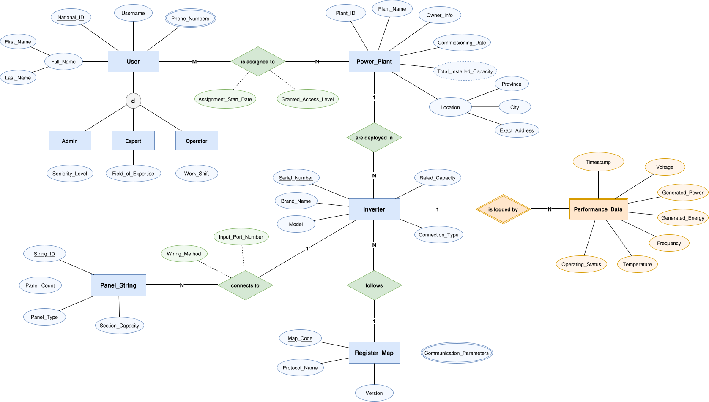

# Phase 2 — ER Model

**🇬🇧 English | 🇮🇷 [فارسی](02-er-diagram.fa.md)**

Input: [`01-requirements.md`](01-requirements.md)
Diagram (EN): [`../diagrams/Helios-db-ER.drawio.svg`](../diagrams/Helios-db-ER.drawio.svg) · source [`../diagrams/er.drawio`](../diagrams/er.drawio)

## 1. Entities

| Entity | Attributes | Candidate key | Notes |
|---|---|---|---|
| **User** | `National_ID`, `Username`, `Full_Name` (`First_Name`, `Last_Name`), `{Phone_Numbers}` | `National_ID`, `Username` | Strong entity (Supertype). `Full_Name` is composite; `Phone_Numbers` is multi-valued. |
| **Admin** | `Seniority_Level` | Inherited (`National_ID`) | Subtype of **User**. |
| **Expert** | `Field_of_Expertise` | Inherited (`National_ID`) | Subtype of **User**. |
| **Operator** | `Work_Shift` | Inherited (`National_ID`) | Subtype of **User**. |
| **Power_Plant** | `Plant_ID`, `Plant_Name`, `Owner_Info`, `Commissioning_Date`, `Location` (`Province`, `City`, `Exact_Address`), `/Total_Installed_Capacity/` | `Plant_ID` | Strong entity. `Location` is composite; `Total_Installed_Capacity` is derived from the sum of inverter capacities. |
| **Inverter** | `Serial_Number`, `Brand_Name`, `Model`, `Rated_Capacity`, `Connection_Type` | `Serial_Number` | Strong entity representing the core hardware converter in a plant. |
| **Panel_String** | `String_ID`, `Panel_Count`, `Panel_Type`, `Section_Capacity` | `String_ID` | Strong entity representing a series/parallel array of solar panels. |
| **Register_Map** | `Map_Code`, `Protocol_Name`, `Version`, `{Communication_Parameters}` | `Map_Code` | Strong entity. `Communication_Parameters` is a multi-valued attribute. |
| **Performance_Data** | `Timestamp` (Partial Key), `Voltage`, `Generated_Power`, `Generated_Energy`, `Frequency`, `Temperature`, `Operating_Status` | `(Serial_Number, Timestamp)` | **Weak entity** dependent on **Inverter**. Stores time-series operational logs. |

## 2. Relationships

| Relationship | Entities | Cardinality | Participation | Notes |
|---|---|---|---|---|
| **is assigned to** | **User** — **Power_Plant** | M:N | Partial (`User`) — Total (`Power_Plant`) | Includes relationship attributes: `Assignment_Start_Date` and `Granted_Access_Level`. |
| **are deployed in** | **Power_Plant** — **Inverter** | 1:N | Partial (`Power_Plant`) — Total (`Inverter`) | Each inverter must belong to exactly one power plant. |
| **connects to** | **Inverter** — **Panel_String** | 1:N | Partial (`Inverter`) — Total (`Panel_String`) | Includes relationship attributes: `Wiring_Method` and `Input_Port_Number`. |
| **follows** | **Inverter** — **Register_Map** | N:1 | Total (`Inverter`) — Partial (`Register_Map`) | Every inverter must follow one register map based on its model. |
| **is logged by** | **Inverter** — **Performance_Data** | 1:N | Partial (`Inverter`) — Total (`Performance_Data`) | **Identifying relationship** for the weak entity `Performance_Data`. |

## 3. Weak entities & identifying relationships

- **Weak Entity:** `Performance_Data`
- **Owner (Identifying) Entity:** `Inverter`
- **Identifying Relationship:** `is logged by` (1:N, with total participation on the `Performance_Data` side).
- **Discriminator (Partial Key):** `Timestamp`
- **Explanation:** Time-series telemetry logs (`Voltage`, `Generated_Power`, `Temperature`, etc.) do not have a globally unique identifier of their own and cannot exist without a physical inverter. A specific log record is uniquely identified by combining the owner inverter's `Serial_Number` with the `Timestamp` of when the reading was captured.

## 4. Specialization / generalization

- **Supertype:** `User`
- **Subtypes:** `Admin`, `Expert`, `Operator`
- **Constraint Type:** **Disjoint (`d`)** and **Total**
- **Explanation:** Every user registered in the monitoring system has a specific organizational role that dictates their attributes and permissions. A user takes on one distinct role (`Admin` with `Seniority_Level`, `Expert` with `Field_of_Expertise`, or `Operator` with `Work_Shift`), and all subtypes inherit the primary key (`National_ID`) and common attributes (`Username`, `Full_Name`, `Phone_Numbers`) from `User`.

## 5. Constraints

- **Derived Attribute Calculation:** `Total_Installed_Capacity` in `Power_Plant` must be computed dynamically (via a SQL `VIEW` or trigger) as `SUM(Rated_Capacity)` of all inverters deployed in that plant.
- **Referential Integrity & Cascading:** Deleting an `Inverter` should cascade delete its dependent `Performance_Data` records (`ON DELETE CASCADE`), while deleting a `Register_Map` or `Power_Plant` that has active inverters must be restricted (`ON DELETE RESTRICT`).
- **Domain & Check Constraints:**
  - `Rated_Capacity`, `Section_Capacity`, and `Panel_Count` must be strictly positive (`> 0`).
  - `Wiring_Method` in the `connects to` relationship must be restricted to valid values (e.g., `'Series'`, `'Parallel'`, `'Series-Parallel'`).
  - `Input_Port_Number` must be unique per inverter (`UNIQUE(Inverter_Serial_Number, Input_Port_Number)`), ensuring two strings are not plugged into the exact same physical port on the same inverter.
- **Unique Constraints:** `Username` in `User` must be enforced as `UNIQUE` in addition to the primary key `National_ID`.

## 6. Traceability

| Requirement | Entities / relationships |
|---|---|
| **1.1** Store user profiles, contact details, and unique IDs | `User` (`National_ID`, `Username`, `Full_Name`, `Phone_Numbers`) |
| **1.2** Distinct user roles and role-specific attributes | Specialization of `User` into `Admin`, `Expert`, and `Operator` |
| **1.3** Power plant registration and automatic capacity tracking | `Power_Plant` (`Plant_ID`, `Plant_Name`, `Owner_Info`, `Location`, `Commissioning_Date`, `/Total_Installed_Capacity/`) |
| **1.4** Assigning users to monitor power plants with access levels | `is assigned to` (M:N between `User` and `Power_Plant` with `Assignment_Start_Date`, `Granted_Access_Level`) |
| **2.1** Deploying multiple inverters within a power plant | `Inverter`, `are deployed in` (1:N between `Power_Plant` and `Inverter`) |
| **2.2** Connecting panel strings to inverters with port/wiring details | `Panel_String`, `connects to` (1:N between `Inverter` and `Panel_String` with `Wiring_Method`, `Input_Port_Number`) |
| **3.1** Managing model-specific register maps and communication parameters | `Register_Map`, `follows` (N:1 between `Inverter` and `Register_Map`) |
| **3.2** Storing time-series operational telemetry per inverter | `Performance_Data` (Weak Entity), `is logged by` (Identifying Relationship with `Inverter`) |

## 7. Diagram

The Persian version of this diagram is in [`02-er-diagram.fa.md`](02-er-diagram.fa.md).
